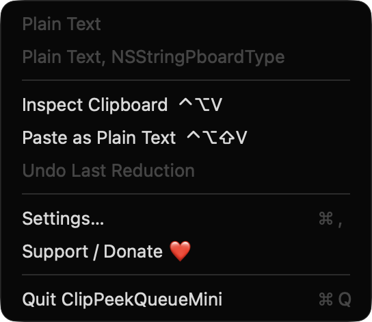
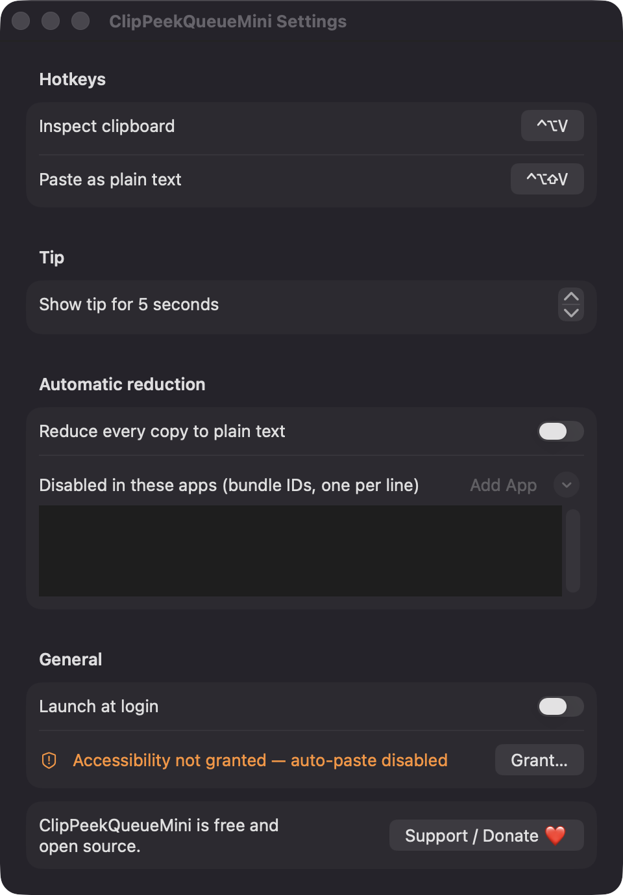

# ClipPeekQueueMini

**🌐 Website:** [turhe123.github.io/clip-peek-queue-mini](https://turhe123.github.io/clip-peek-queue-mini/)

Preview what is on your clipboard in a tiny floating tip before you paste, with formats and size shown.

> 🆓 A free, open-source **Pure Paste alternative** for macOS 14+. Native Swift, no accounts, no subscriptions, MIT licensed.


## Why

ClipPeekQueueMini is a free, open-source, 100% native, backend-free alternative to paid utilities in the *Clipboard* category. It was inspired by small paste helpers such as Paste Plain Hotkey: Pure Paste ($4.99 one-time). Instead of a history manager, it is a clipboard inspector: it shows exactly what is on the pasteboard right now, in every format, and lets you strip it down to one format with a keystroke. Everything runs locally and no data leaves your Mac.

## Features

- **Floating tip** (default hotkey `⌃⌥V`) shown near the pointer. It is a non-activating panel with a material background, so it doesn't steal focus. It auto-hides after a configurable time (2–20 s, default 5 s) and stays open while the pointer is over it.
- **Preview** of text (first lines, monospaced) or an image thumbnail, or the first file path for file copies.
- **Size and format info**: character count, pixel dimensions, file count, total bytes, and a per-type list with friendly names and byte sizes (first 8 types, with a "+ N more" note).
- **Four one-key reductions** in the tip: `P` plain text, `F` first file path, `I` PNG image, `T` trimmed single line.
- **Paste as Plain Text** hotkey (default `⌃⌥⇧V`) reduces the clipboard and sends ⌘V to the frontmost app.
- **Undo**: the last five reductions are logged with the original pasteboard items, so you can restore any of them from the tip (`U`) or the menu.
- **Menu bar item** with a live clipboard summary and an icon that changes with content type. Menu: Inspect Clipboard, Paste as Plain Text, Undo Last Reduction, Recent Reductions, Settings, Support, Quit.
- **Automatic reduction (optional, off by default)**: reduces every foreign rich-text copy to plain text. It skips concealed, transient and auto-generated pasteboard content (for example password managers), ignores the app's own writes, and can be disabled per app by bundle ID.
- **Off-main-thread image work**: thumbnails and PNG conversion run in the background. If the clipboard changes mid-conversion, the app uses the latest content.
- **Settings**: record both hotkeys, tip duration, auto-reduce and excluded apps, launch at login.
- Empty clipboard shows a "Clipboard is empty" message.

## Screenshots

<p align="center"></p>

<p align="center"><em>The menu bar menu shows a live summary of what is on the clipboard and its formats, plus Inspect Clipboard, Paste as Plain Text and Undo Last Reduction with their hotkeys.</em></p>

<p align="center"></p>

<p align="center"><em>In Settings you can record both hotkeys, set how long the tip stays up, turn on automatic plain-text reduction with per-app exclusions, and enable launch at login.</em></p>

## Install

1. Download `ClipPeekQueueMini-macOS.zip` from the [latest release](https://github.com/turhe123/clip-peek-queue-mini/releases/latest).
2. Unzip it and move `ClipPeekQueueMini.app` to `/Applications`.
3. Because the app is open source and not notarized, run:

   ```bash
   xattr -cr /Applications/ClipPeekQueueMini.app
   ```

4. Right-click the app and choose **Open** the first time.

Requires macOS 14.0 or later.

## Build from source

```bash
brew install xcodegen
xcodegen generate
xcodebuild -project ClipPeekQueueMini.xcodeproj -scheme ClipPeekQueueMini -configuration Release -derivedDataPath ./build build
```

The app is produced at `build/Build/Products/Release/ClipPeekQueueMini.app`.

## Permissions

- **Accessibility** (optional): needed only to send the ⌘V keystroke for the *Paste as Plain Text* hotkey. It is requested lazily the first time you use paste, with an explanation first. Without it, the clipboard is still reduced to plain text and you press ⌘V yourself. Nothing else is read or recorded.
- **Launch at login** (optional): uses the system login-item service, only if you enable it in Settings.

The app does not request Screen Recording, Microphone, Camera, or network access, and it has no backend.

## Built with AI

ClipPeekQueueMini was written by [Claude Code](https://claude.com/claude-code) inside an automated pipeline, from a plain-English spec. No code, binaries or assets from any commercial app were used; it is a clean-room reimplementation of a feature set, not a copy.

What that means in practice:

- The full source is in this repo under the MIT license. Read it before you run it.
- No network calls, no analytics, no third-party dependencies. Only Apple frameworks.
- Ad-hoc signed and not notarized, which is why Gatekeeper warns on first launch.
- It has had less human review than a hand-written app. Bug reports and pull requests are welcome.

## Support ❤️

If this app is useful to you, you can support its development:

[Support Or (Leo) Davidai ❤️](https://ko-fi.com/leodavidai)

## More free Mac apps

ClipPeekQueueMini is one of a growing collection of [free, open-source Mac utilities](https://github.com/turhe123/mac-apps) built the same way: native Swift, no accounts, no telemetry. Browse the full gallery at [turhe123.github.io/mac-apps](https://turhe123.github.io/mac-apps/).

Prefer something that runs in the browser? The same pipeline builds [free, private web tools](https://turhe123.github.io/web-tools/): PDF, image, developer, data and audio tools, nothing uploaded.

## License

MIT © Or Davidai Bachar
